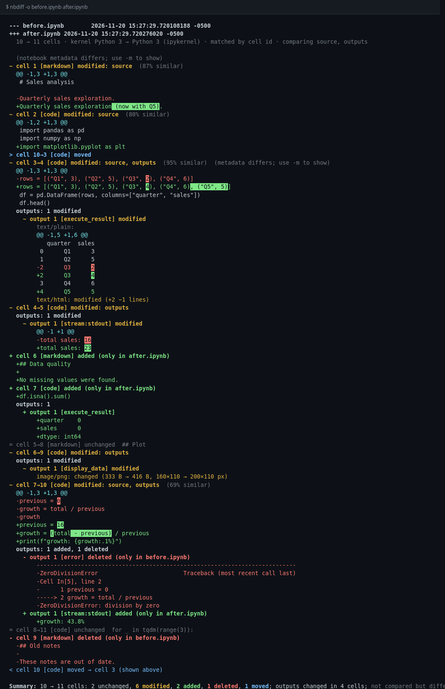

# nbdiff

**`diff` for Jupyter notebooks.** `nbdiff` compares `.ipynb` files *cell by cell*.
It tells you, for every cell, whether it is **unchanged**, **modified**, **added**
(only in the second notebook), **deleted** (only in the first) or **moved**. It shows
readable diffs of the cell sources and, on request, of the **outputs** (text, HTML,
images, errors), **metadata** and **execution counts**.

It accepts the familiar GNU `diff` options (`-u`, `-c`, `-y`, `-q`, `-s`, `-r`, `-N`,
`-i`, `-b`, `-w`, `-B`, `-I RE`, `--label`, `--color`, ...) and the same exit status.
It also works across git revisions (`--diff main feature`), and it can write the
whole diff as a rendered notebook (`--visualize diff.ipynb`). There, plots and
tables from *before* and *after* appear next to each other.

Pure Python 3.10+ standard library, no dependencies.



## Why

A notebook is a JSON document. `git diff` and `diff` show you escaped JSON strings,
base64 image blobs, execution counts and metadata noise, and a one-line edit can look
like a rewrite. `nbdiff` parses the notebook and pairs up the cells that correspond,
then reports changes the way you think about them: *"cell 3 → 4 modified: source,
outputs; output 1 image/png changed 160×110 → 200×110 px"*.

## Install

```bash
git clone <this repo> nbdiff && cd nbdiff
./install.sh              # symlinks bin/nbdiff into ~/.local/bin (or: ./install.sh ~/bin)
# or
pip install .             # installs the `nbdiff` console script
```

Bash completion: `source completions/nbdiff.bash` (add it to `~/.bashrc`).

> **Note:** [nbdime](https://github.com/jupyter/nbdime) also installs a command named
> `nbdiff`. If you have both, whichever comes first on your `PATH` wins
> (`install.sh` warns you about this).

## Quick start

```bash
nbdiff before.ipynb after.ipynb            # cell sources (unified format)
nbdiff -o before.ipynb after.ipynb         # ... plus outputs
nbdiff -A before.ipynb after.ipynb         # everything: outputs, metadata, execution counts
nbdiff --stat -A before.ipynb after.ipynb  # one line per changed cell
nbdiff -q -r old_dir/ new_dir/             # which notebooks differ
nbdiff --visualize diff.ipynb before.ipynb after.ipynb   # write a rendered diff notebook

nbdiff --diff                              # git: working tree vs index (unstaged changes)
nbdiff --diff main feature                 # git: notebooks that differ between two branches
nbdiff --diff origin/main... --visualize review.ipynb    # review a branch as a notebook
```

Try it on the bundled examples: `nbdiff -o examples/before.ipynb examples/after.ipynb`.
[`examples/visualized-diff.ipynb`](examples/visualized-diff.ipynb) is what `--visualize`
produced for them (GitHub renders it).

## What gets reported

Every cell gets a status line:

| marker | status | meaning |
|:-:|---|---|
| `=` | **unchanged** | no difference in the compared aspects (runs of these are collapsed) |
| `~` | **modified** | same cell in both notebooks, but something differs; the line lists what: `type`, `source`, `outputs`, `metadata`, `attachments`, `execution count`, plus how similar the sources are |
| `+` | **added** | the cell exists only in the second notebook |
| `-` | **deleted** | the cell exists only in the first notebook |
| `>` / `<` | **moved** | the cell changed position (shown at its new place, with a pointer at the old one) |

Cell numbers are 1-based. `cell 3→4` means cell 3 of the first notebook is cell 4 of
the second.

What is compared:

| aspect | default | flag |
|---|---|---|
| cell type and source | always | |
| outputs | no | `-o, --outputs` |
| cell + notebook metadata, attachments | no | `-m, --metadata` |
| execution counts | no | `--execution-count` |
| all of the above | | `-A, --all` |

Aspects that are *not* compared but differ are still pointed out, for example
`(outputs differ; use -o to show)` on the cell line and `not compared but different:
outputs` in the summary. If the notebooks are identical in what was compared, nothing is
printed (like `diff`). A note on stderr tells you about differences that were not
compared.

### Outputs (`-o`)

Outputs are normalized before comparison, so the diff shows what you would *see*:

* stream outputs that Jupyter split into chunks are merged;
* carriage returns are applied the way a frontend renders them, so a tqdm progress bar
  that only redrew differently counts as unchanged;
* ANSI colour codes in tracebacks are stripped;
* JSON outputs (widgets, Plotly, Vega...) are pretty-printed and diffed line by line;
* images and other binary data are compared by content and summarised by size and pixel
  dimensions: `image/png: changed (333 B → 416 B, 160×110 → 200×110 px)`;
* for rich outputs with several representations (e.g. a DataFrame's `text/plain` +
  `text/html`), the most readable one is diffed and the others are summarised.

Added or deleted outputs are printed in full up to `--max-lines` (default 50) lines.

## How cells are matched

1. **Cell ids.** If both notebooks have nbformat ≥ 4.5 cell ids and enough of them are
   shared, cells with the same id correspond. Ids that appear out of order are moves.
2. **Content.** Otherwise, cells with identical type and source are used as anchors
   (longest matching blocks, like `diff` does with lines). Between anchors, the remaining
   cells are paired by similarity with an order-preserving alignment. Pairs below
   `--match-threshold` (default 0.5) count as deleted + added instead of modified.
3. **Moves.** A deleted and an added cell with near-identical source (≥ 80%) are reported
   as one moved cell. Disable with `--no-moves`.

Force a strategy with `--match=id` or `--match=content`. The header line says which one
was used. The whitespace/case options (`-b`, `-w`, `-i`, `-B`, `-I RE`) also apply when
matching cells.

## `--visualize FILE`: a diff you can open in Jupyter

Instead of printing, `nbdiff --visualize diff.ipynb a.ipynb b.ipynb` writes a normal
notebook (nbformat 4.5, valid against the official schema). It renders in JupyterLab,
Jupyter Notebook, VS Code, nbviewer and on GitHub without any extension:

* **Overview**: both notebooks (cells, kernel, nbformat, modification time), status
  totals, what was compared, and a *changes at a glance* table.
* **One section per changed cell**: a heading with a coloured status (🟡 modified,
  🟢 added, 🔴 deleted, 🔵 moved), what changed, the similarity, and the source diff as a
  ` ```diff ` block (highlighted by every frontend). Changed text outputs and metadata
  are diffed the same way.
* **Before / After cells**: when a cell's outputs differ, two real code cells follow.
  One holds the original outputs from the first notebook, the other the outputs from the
  second. So plots, images, HTML tables and errors render natively, one above the other.
  Their code is collapsed (expand it in JupyterLab), and the execution counts are the
  original ones.
* **Unchanged cells** are folded into `<details>` blocks. `--unchanged=show` copies them
  verbatim, so the diff notebook reads like the full notebook with the changes
  annotated.

`--visualize` implies `-o -m` (outputs and metadata). Turn aspects off with
`--no-outputs`, `--no-metadata` or `--sources-only`. Use `-` as FILE to write the
notebook to stdout. `nbdiff` refuses to overwrite one of the input notebooks. With
`--diff` or `-r`, every changed notebook gets its own section in one combined diff
notebook. Each generated cell carries `metadata.nbdiff` (status, cell indices, role) and
an `nbdiff-<status>` tag, so the result is machine-readable too.

## Git

### `--diff`: compare revisions

With `--diff` (alias `--git`), the arguments are read the same way `git diff` reads
them. The changed `.ipynb` files are found with `git diff --name-status -M` and each one
is diffed cell by cell:

```bash
nbdiff --diff                       # working tree vs index (unstaged changes)
nbdiff --diff --cached              # index vs HEAD (staged changes; alias --staged)
nbdiff --diff HEAD                  # working tree vs HEAD
nbdiff --diff main                  # working tree vs branch main
nbdiff --diff --cached main         # index vs main
nbdiff --diff main feature          # main vs feature
nbdiff --diff main..feature         # same
nbdiff --diff origin/main...HEAD    # what HEAD changed since it forked from origin/main
nbdiff --diff HEAD~5 -- notebooks/  # limit to paths
nbdiff --diff -o origin/main... --visualize review.ipynb
```

Sides are labelled `rev:path` (`main:nb/analysis.ipynb`, `index:...`; working-tree files
by their path). Renames are detected, and a pure rename is reported as such. New and
deleted notebooks are diffed against an empty notebook. The exit status is 1 if any
notebook differs. All other options (`-o`, `-A`, `--stat`, `-q`, `-w`, `--json`, ...)
work as usual.

### Plugging into git's own commands

`nbdiff` also speaks git's external-diff protocol, so you can make `git diff` itself use
it for notebooks:

```bash
git config diff.nbdiff.command 'nbdiff --color=always'
echo '*.ipynb diff=nbdiff' >> .gitattributes
git diff                     # notebooks now diffed by nbdiff, everything else as usual
```

Or one-off: `GIT_EXTERNAL_DIFF=nbdiff git diff main`, or the difftool route:
`git difftool -y -x 'nbdiff -o' main -- '*.ipynb'`. Non-notebook files that reach
`nbdiff` this way are passed through to plain `diff -u`.

## Options

`nbdiff --help` lists everything. In summary:

**Notebook options**

| option | |
|---|---|
| `-o`, `--outputs` | also compare outputs |
| `-m`, `--metadata` | also compare cell/notebook metadata and attachments |
| `--execution-count` | also compare execution counts |
| `-A`, `--all` | all of the above |
| `--no-outputs`, `--no-metadata`, `--no-execution-count`, `--sources-only` | turn aspects off |
| `--visualize=FILE` | write a rendered diff notebook instead of printing |
| `--match=auto\|id\|content`, `--match-threshold=X`, `--no-moves` | cell matching |
| `--ignore-metadata=PAT` | ignore metadata keys (dotted path glob), e.g. `execution`, `ExecuteTime`, `collapsed`, `language_info.*` |
| `--ignore-mime=PAT` | ignore output mimetypes, e.g. `'image/*'`, `text/html` |
| `--unchanged=collapse\|list\|show\|hide`, `--suppress-common-cells` | how unchanged cells are shown |
| `--max-lines=NUM` | limit for printing added/deleted outputs (0 = no limit) |
| `--stat` | only the per-cell status lines with change counts |
| `--json` | machine-readable output |
| `--no-summary`, `--no-intraline` | less decoration |
| `--diff`/`--git`, `--cached`/`--staged` | git revision mode |

**diff(1)-compatible options:** `--normal`, `-u`/`-U NUM`/`--unified[=NUM]` (default
format), `-c`/`-C NUM`/`--context[=NUM]`, `-y`/`--side-by-side`, `-W NUM`,
`--left-column`, `--suppress-common-lines`, `-q`, `-s`, `-r`, `-N`,
`--unidirectional-new-file`, `-x PAT`, `-X FILE`, `-S FILE`, `--from-file`, `--to-file`,
`-i`, `-E`, `-Z`, `-b`, `-w`, `-B`, `-I RE`, `--strip-trailing-cr`, `-d`,
`--speed-large-files`, `-t`, `-T`, `--tabsize`, `--label` (×2), `--color[=WHEN]`, `-v`,
`--help`. The whitespace, case, blank-line and regex options apply to sources *and* text
outputs. For example, `-o -I 'took [0-9.]+ s'` ignores timing lines in outputs.

**Exit status:** 0 if the inputs are the same, 1 if they differ, 2 if there was trouble
(missing file, invalid notebook, bad option).

### Differences from GNU diff

* The default format is unified (`-u`), shown per cell with a status line per cell.
  `--normal` gives the classic format. The output is a report, not a patch.
* `--color` defaults to `auto` (on for terminals; honours `NO_COLOR`).
* In directory mode only `*.ipynb` files are compared, and `.ipynb_checkpoints` is
  skipped.
* Formats GNU diff has but nbdiff does not: `-e`/`--ed`, `-n`/`--rcs`, `-D`/`--ifdef`,
  `--line-format` and friends, `-p`. `--horizon-lines` is accepted and ignored.

## JSON output

`nbdiff --json [-A] a.ipynb b.ipynb` prints the following, for use in scripts or CI:

```json
{
  "nbdiff_version": "0.1.0",
  "identical": false,
  "comparisons": [{
    "a": {"path": "before.ipynb", "cells": 10, "kernel": "Python 3", "nbformat": "4.5", "exists": true},
    "b": {"path": "after.ipynb", "...": "..."},
    "matched_by": "id",
    "compared": ["source", "outputs"],
    "counts": {"unchanged": 2, "modified": 6, "added": 2, "deleted": 1, "moved": 1},
    "cells": [
      {"status": "modified", "a_index": 4, "b_index": 5, "cell_type": "code", "id": "total",
       "changed": ["outputs"],
       "outputs": {"counts": {"modified": 1}, "changes": [
         {"status": "modified", "output_type": "stream", "name": "stdout",
          "parts": [{"name": "text", "change": "modified",
                     "diff": ["@@ -1 +1 @@", "-total sales: 16", "+total sales: 23"]}]}]}}
    ]
  }]
}
```

## Development

```bash
python3 -m unittest discover -s tests -t tests -v   # no dependencies needed
python3 examples/make_examples.py                  # regenerate the example notebooks
```

The test suite includes a byte-for-byte comparison of the unified/context/normal hunks
against GNU `diff` on fixed and randomized inputs, plus end-to-end tests of `--diff`
and git's external-diff protocol against a temporary repository.

| module | |
|---|---|
| `nbdiff/notebook.py` | loading nbformat v3/v4 into a small `Notebook`/`Cell` model |
| `nbdiff/textdiff.py` | line diff with GNU comparison options; unified/context/normal/side-by-side |
| `nbdiff/outputs.py` | output normalization and output-level diffs |
| `nbdiff/align.py` | cell matching (ids, anchors, fuzzy DP alignment, moves) |
| `nbdiff/diff.py` | the notebook diff model (per-cell status, aspects, hints) |
| `nbdiff/render_term.py`, `render_nb.py`, `render_json.py` | terminal, `--visualize` and `--json` renderers |
| `nbdiff/gitmode.py` | `--diff` and the git external-diff protocol |
| `nbdiff/cli.py` | option parsing (GNU style) and orchestration |
